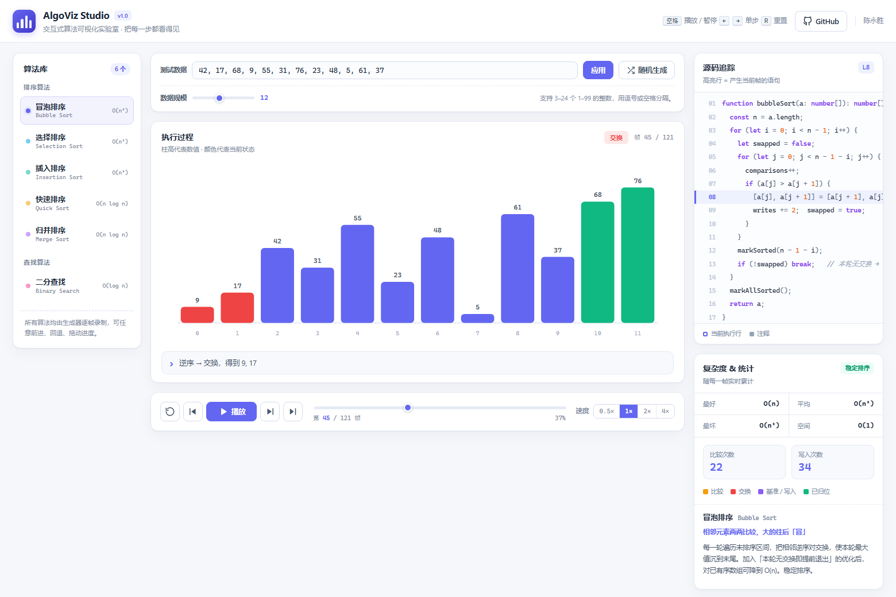

# AlgoViz Studio · 交互式算法可视化实验室

> 把算法的**每一步**录成可回放的执行帧：单步 / 回退 / 变速 / 拖动进度，柱状图与源码行实时同步高亮。
> 纯前端项目，React + TypeScript + Vite，零后端依赖。

[](https://github.com/3223-tk/algo-viz-studio/actions/workflows/ci.yml)
[](./LICENSE)


**在线 Demo：** <https://3223-tk.github.io/algo-viz-studio/>



---

## 为什么做这个

上算法课时最难受的一点是：伪代码看得懂，但「这一趟循环之后数组到底变成什么样了」只能靠脑子跑。
网上的可视化动画大多只能从头播到尾，没法暂停、没法往回看，也不告诉你当前执行到哪一行源码。

所以这里有两条硬要求：

1. **任意跳转** —— 能前进、能回退、能直接拖到第 137 帧，而不是只能重播一遍；
2. **代码与状态对齐** —— 柱状图变化的同时，右侧源码必须精确高亮产生这一帧的那一行。

## 功能

| 模块       | 说明                                                                                        |
| ---------- | ------------------------------------------------------------------------------------------- |
| 6 个算法   | 冒泡、选择、插入、快速（Lomuto）、归并排序 + 二分查找                                       |
| 播放器     | 播放 / 暂停 / 上一步 / 下一步 / 重置 / 跳到结尾 / 拖动进度 / 0.5×–4× 变速                   |
| 可视化     | SVG 柱状图；比较橙、交换红、基准与写入紫、已归位绿、查找中已排除灰；区间背景框、target 虚线 |
| 源码追踪   | 当前执行行高亮并自动滚入视口，轻量语法着色，不引入高亮库                                    |
| 自定义数据 | 手输数组（逗号 / 空格分隔）、随机生成、3–24 条数据规模、查找目标值                          |
| 实时统计   | 比较次数、写入次数随帧累计；最好 / 平均 / 最坏时间复杂度、空间复杂度、稳定性                |
| 键盘操作   | <kbd>空格</kbd> 播放暂停、<kbd>←</kbd> <kbd>→</kbd> 单步、<kbd>R</kbd> 重置                 |
| 执行帧分享 | URL 加 `?frame=42` 可直达任意一帧，方便把某一步直接发给别人                                 |
| 响应式     | 三栏 / 双栏 / 单栏自适应，窄屏可用                                                          |

## 技术栈

- **React 18 + TypeScript 5.7（strict）** —— 所有帧、状态、动作都有完整类型
- **Vite 6** —— 构建，`base: './'` 让同一份产物在本地与 GitHub Pages 子路径下都能跑
- **Vitest 2** —— 57 个单元测试，覆盖算法正确性、帧不变量、播放器状态机边界
- **ESLint 9 (flat config) + Prettier 3** —— CI 中强制校验
- **GitHub Actions** —— 推送自动跑 CI，main 分支自动部署 Pages

## 架构

```mermaid
flowchart LR
    A[算法生成器<br/>function*] -->|yield Frame| B[执行帧数组<br/>Frame[]]
    B --> C[播放器状态机<br/>useReducer]
    C -->|当前 Frame| D[柱状图 ArrayCanvas]
    C -->|frame.line| E[源码面板 CodePanel]
    C -->|frame.stats| F[统计面板 StatsPanel]
    G[用户输入 / 算法切换] --> A
    G --> C
```

核心分层：

| 层     | 位置                         | 职责                                                                                             |
| ------ | ---------------------------- | ------------------------------------------------------------------------------------------------ |
| 帧协议 | `src/algorithms/types.ts`    | 定义一帧包含什么：数组快照、代码行号、动作类型、活跃下标、已归位下标、基准、区间、统计、中文解说 |
| 录制器 | `src/algorithms/recorder.ts` | 每个算法持有一个 `Recorder`，负责拷贝数组快照、累计比较 / 写入次数                               |
| 算法层 | `src/algorithms/*.ts`        | 用 `function*` 在每条关键语句后 `yield` 一帧；快速 / 归并排序用 `yield*` 委托递归子过程          |
| 状态机 | `src/core/player.ts`         | 与 React 无关的纯函数 `playerReducer`，所有跳转 / 越界 / 自动暂停规则都在这里                    |
| Hook   | `src/hooks/usePlayer.ts`     | 把生成器一次性展开为 `Frame[]`，用 `setInterval` 按速度推进，暴露稳定的控制函数                  |
| 视图层 | `src/components/*.tsx`       | 只消费当前 `Frame`，不持有算法状态                                                               |

### 三个值得展开的设计点

**1. 为什么用生成器，而不是在组件里一边跑一边 setState？**
生成器把「算法逻辑」和「播放节奏」彻底解耦：算法只管按顺序产出状态，UI 想多快、想倒退、想跳到第几帧都跟算法本身无关。`Array.from(generator)` 一次性物化成数组后，任意帧都是 O(1) 随机访问——这是「能回退」的前提。代价是会占用 O(帧数 × 数组长度) 的内存，本项目的规模（≤24 个元素、几百帧）完全可接受。

**2. 代码行号怎么保证不错位？**
每个算法把展示用的源码字符串数组和 `yield` 时的 `line` 一并维护，行号是 1-based，对应 `code[line - 1]`。单元测试会遍历所有帧，断言 `1 <= line <= code.length`，所以改动代码展示时漏改行号会直接被 CI 拦下。

**3. 播放器为什么拆成纯 reducer？**
播放 / 暂停 / 到末尾自动停 / 在末帧点播放要回到开头 / 切换算法重置进度——这些边界条件很容易漏。抽成纯函数后可以直接对每种转移写单测，不需要 DOM 和 React 测试库，Hook 只负责定时器和 `useMemo`。

## 本地运行

```bash
git clone https://github.com/3223-tk/algo-viz-studio.git
cd algo-viz-studio
npm install
npm run dev          # http://localhost:5173
```

一条命令跑完所有校验（CI 用的是同一套）：

```bash
npm run verify       # typecheck → lint → format:check → test → build
```

其他脚本：`npm run build`（含类型检查）、`npm run preview`、`npm run test:watch`、`npm run format`。

## 目录结构

```
algo-viz-studio/
├── .github/workflows/
│   ├── ci.yml              # 类型检查 / lint / 格式 / 单测 / 构建
│   └── deploy.yml          # 构建并部署 GitHub Pages
├── docs/screenshot.png     # README 界面预览
├── src/
│   ├── algorithms/         # 帧协议、录制器、6 个算法、注册表、算法单测
│   ├── components/         # Header / Sidebar / Toolbar / Canvas / Code / Controls / Stats
│   ├── core/               # 播放器状态机、工具函数、标签映射
│   ├── hooks/usePlayer.ts  # 帧调度 Hook
│   ├── App.tsx
│   ├── main.tsx
│   └── styles.css
└── vite.config.ts / vitest.config.ts / eslint.config.js / tsconfig.json
```

> `vite.config.ts` 与 `vitest.config.ts` 刻意分开：Vitest 2 自带一份 Vite 类型树，与顶层 Vite 6 的 `Plugin` 类型不兼容，混在一个文件里会让 `tsc` 报错。

## 测试覆盖

`npm run test` → **57 个用例全绿**，覆盖：

- 5 个排序算法 × 7 组输入（空数组、单元素、全相同、已有序、逆序、含重复、随机），断言结果正确、**不修改调用方数组**、末帧全部归位；
- 所有帧的通用不变量：数组长度不变、行号合法、解说非空、比较 / 写入计数单调不减；
- 二分查找：能命中每一个元素、找不到时给出 miss、比较次数满足 O(log n)、空数组安全；
- 播放器状态机：前后越界、末帧自动暂停、末帧重播、seek / speed 钳制、切换算法重置、reset 保留速度；
- 注册表：id 唯一、代码与默认数据完整、查找类默认输入有序。

## 后续计划

- [ ] 增加堆排序、BFS / DFS、Dijkstra 的图可视化（需要新的渲染器）
- [ ] 支持两个算法同屏对比播放
- [ ] 导出当前执行过程为 GIF / WebM
- [ ] 英文 README 与 i18n

## License

[MIT](./LICENSE) © 2026 陈永胜
